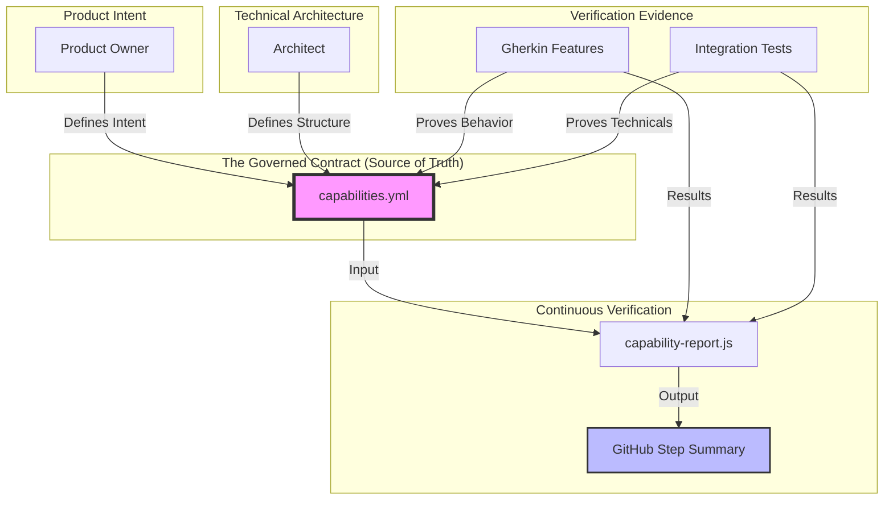
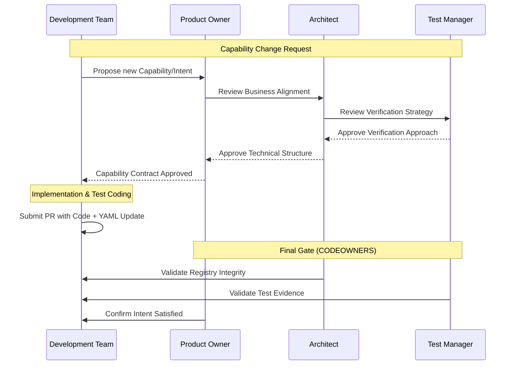
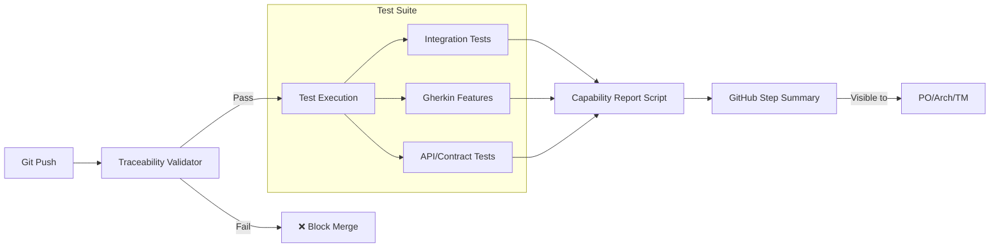
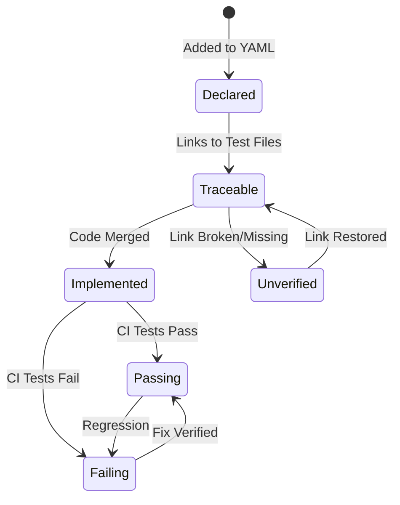

Here is the complete, professional document in copy-pastable Markdown. I have optimized the Mermaid syntax specifically for GitHub's rendering engine.

***

# Governed Capability Contract

## Purpose

The capability registry defines what the system claims to support and establishes a governed, traceable relationship between product intent, architecture, implementation, and verification.

The goal is to make system capabilities explicit, independently governed, and continuously verifiable through CI.



The capability registry is not merely documentation. It is a controlled contract that defines the system's declared capabilities and links them to the evidence used to verify them.

## Core Principles

1. **Capabilities are explicit.** The system's supported capabilities are declared in a structured, version-controlled registry.
2. **Capabilities have accountable owners.** Product, architecture, and quality responsibilities are clearly assigned.
3. **The contract is independently governed.** Developers cannot unilaterally redefine the system's declared capabilities or weaken the rules used to verify them.
4. **Verification is traceable.** Every active capability must reference appropriate verification artifacts.
5. **Verification is automated.** CI checks registry integrity and traceability and publishes a capability report.
6. **Claims are distinguished from evidence.** Declaring a capability or linking it to a test does not prove that the capability works. Actual test outcomes must be evaluated separately.

## Capability Registry

The canonical capability registry is located at: `capabilities/capabilities.yml`

Each capability has a stable identifier and metadata describing its intent, ownership, lifecycle, and verification references. The registry provides a central answer to:

- What capabilities does the system claim to provide?
- What does each capability mean?
- Who is accountable for the capability?
- When was the capability introduced?
- Which tests and specifications verify it?
- Is its verification traceable and passing?

## Governance and Responsibilities

### Role Matrix and Approval Flow

The governance model ensures that no single person can define a requirement and then "approve" their own implementation of it.



#### Product Owner (PO)
The Product Owner owns the product meaning and business intent of capabilities.
- Approve the introduction and removal of capabilities.
- Approve material changes to capability intent and expected outcomes.

#### Architect
The Architect owns the technical structure and integrity of the capability contract.
- Approve capability identifiers, boundaries, and technical intent.
- Own `scripts/capability-report.js` and maintain reporting logic.

#### Test Manager
The Test Manager owns the adequacy of the verification approach.
- Define and review verification expectations.
- Ensure capabilities have appropriate verification coverage.

#### Development Team
The Development Team owns implementation and the associated verification artifacts.
- Implement capabilities according to the approved contract.
- Resolve CI failures and verification gaps.

## Separation of Duties

The governance model separates three core concerns to ensure an unbiased quality gate:

| Concern | Accountable role |
|---|---|
| Product intent and scope | Product Owner |
| Technical structure and contract integrity | Architect |
| Verification adequacy and quality evidence | Test Manager |
| Implementation and test maintenance | Development Team |

## Change Approval Policy

| Change | Required review |
|---|---|
| Add or remove a capability | Product Owner and Architect |
| Change capability intent or boundaries | Product Owner and Architect |
| Change verification requirements | Test Manager and Architect |
| Change the capability schema | Architect |
| Change report presentation only | Architect |
| Change report semantics or verification interpretation | Architect and Test Manager |
| Change traceability enforcement | Architect and Test Manager |
| Implement a capability | Development Team |
| Update tests or Gherkin scenarios | Development/Test Team |

## GitHub Enforcement

The repository uses `CODEOWNERS` and protected branch rules to enforce this governance model.

```text
# .github/CODEOWNERS
/capabilities/capabilities.yml       @org/architects @org/product-owners @org/test-managers
/scripts/verify-capabilities.js      @org/architects @org/test-managers
/scripts/capability-report.js        @org/architects
/.github/workflows/capability.yml    @org/architects @org/test-managers
```

### Enforcement Requirements
- Require pull requests for protected branches.
- Require code-owner approval for protected files.
- Prevent self-approval where required by organizational policy.
- Ensure changes to validation scripts and workflows receive appropriate review.

### Governance Gap

A tracking gap exists between `.github/CODEOWNERS` and the capability registry:
- `.github/CODEOWNERS` now exists with defined ownership rules for protected files.
- No capability entry in `capabilities.yml` explicitly maps to the CODEOWNERS governance scope.
- This is not a missing product capability, but a documentation gap: the registry should reference that CODEOWNERS enforces the governance model for the files it covers.
- Future capability additions should note their governance enforcement via CODEOWNERS when applicable.

## Continuous Verification

The CI pipeline provides automated checks and reporting to ensure the contract is not just a document, but a living state.



### 1. Traceability Validation
The traceability validator checks that:
- Active capabilities have the required verification references.
- Referenced files and tests actually exist in the file system.
- Capability identifiers and references are structurally valid.

### 2. Capability Reporting
The report is published in the GitHub Actions workflow summary using `GITHUB_STEP_SUMMARY`. It allows stakeholders to see at a glance which business capabilities are functional without reading technical logs.

### 3. Evidence-Based Status
The status of a capability evolves through the following lifecycle:



- **Declared:** The capability exists in the registry.
- **Traceable:** Appropriate verification references exist and are valid.
- **Implemented:** Required implementation work has been completed.
- **Passing:** Relevant verification executed successfully in the current CI run