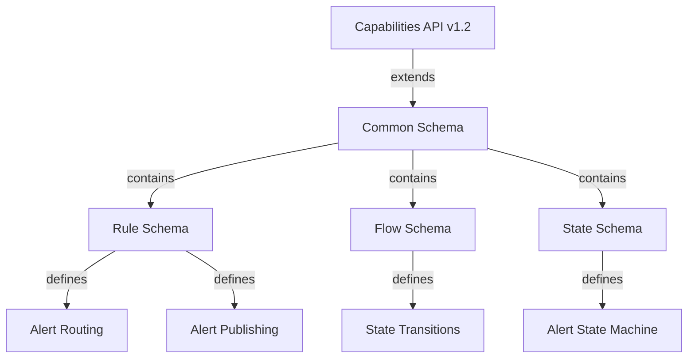
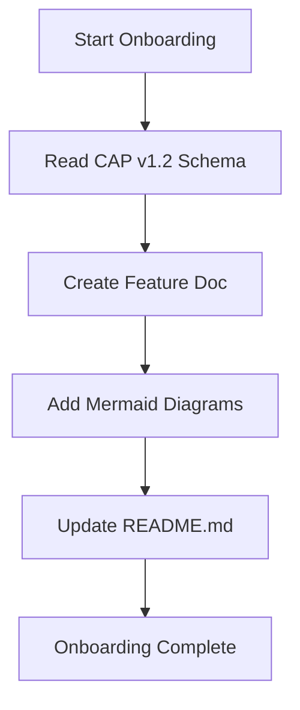

# Project Repository: Drools/Quarkus/React Flow

This repository implements a complex rule designer application.

## 🏗️ Architecture Overview

- **Backend:** A Java Quarkus REST API serves as the application's brain, housing the Apache Drools rules engine. It exposes endpoints for state management and rule execution.
- **Frontend:** A React Flow application consumes the REST API to provide a visual, interactive surface for defining, viewing, and manipulating rules and flow diagrams.
- **Integration:** The Frontend communicates with the Backend via HTTP requests.

## 📁 Structure

- `backend/`: Contains the Quarkus/Java code base (Java, Drools implementation).
- `frontend/`: Contains the React Flow application code base (React, TypeScript).
- `rules/`: Contains the initial set of Drools rule definitions (DRL files).
- `features/`: Contains feature-specific code and documentation, with subdirectories:
  - `features/alerting/`: Alert routing rules producer
  - `features/publication/`: Alert publishing rules producer
  - `features/frontend/`: React Flow application
  - `features/docs/`: Feature documentation and onboarding workflow

## 📚 Documentation

The documentation entrypoint is `README.md`. Additional feature documentation and workflow diagrams are organized in the `docs/` directory.

### CAP v1.2 Schema Relationship

### Docs Onboarding Flow

**README.md Entrypoint Role:** This file serves as the primary documentation entrypoint, providing an overview of the architecture, structure, and current state of the project. It references the `docs/` directory for detailed feature documentation and workflow diagrams.

## 🧪 Capability Testing & Traceability

This project implements CAP v1.2 capability testing with traceability from schema to implementation.

### Schema Traceability

- **CAP v1.2 Schema** (`backend/common/src/main/resources/cap-v1.2.xsd`) defines the rule and flow schemas that the Drools rules engine enforces.
- **Traceability** from CAP schema to implementation:
  - Rule Schema → Alert Routing & Alert Publishing Drools rules
  - Flow Schema → State Transitions & Alert State Machine
- Every capability must be pinned by a spec under `features/` first before implementation.

### Capability Registry

The capability registry (`capabilities/capabilities.yml`) tracks:
- 7 capabilities with 96 scenarios
- 91 scenarios implemented, 5 to do (95% coverage)
- Each capability lists its verified_by implementations (Playwright, backend tests, etc.)
- The registry is verified by `node scripts/verify-capabilities.js`

### Playwright Traceability

- Playwright e2e tests are tagged with `@bdd` and capability tags (`@cap:alert_routing`, etc.)
- Tests run against the live backend/frontend servers
- Traceability ensures every scenario is covered by at least one Playwright test

## 🚧 Current State

The project entrypoint is the README.md. Next: backend/frontend implementation.
