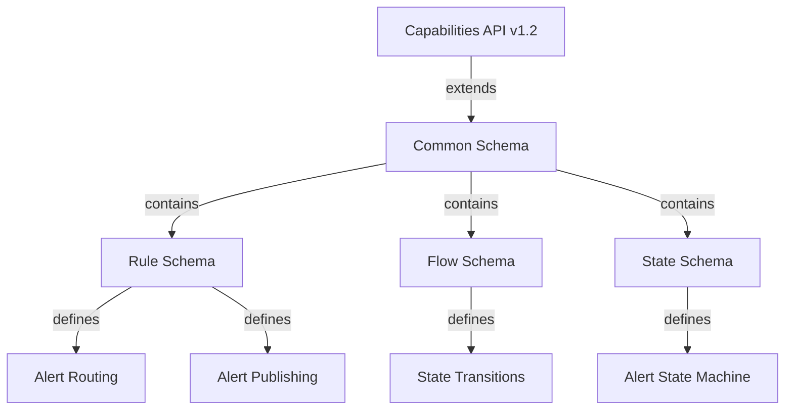
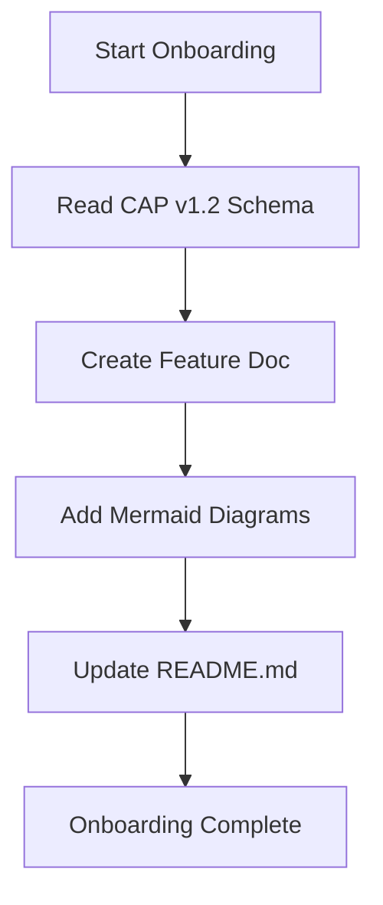

# Project Repository: Drools/Quarkus/React Flow

This repository implements a complex rule designer application.

## 🏗️ Architecture Overview

- **Backend:** A Java Quarkus REST API serves as the application's brain, housing the Apache Drools rules engine. It exposes endpoints for state management and rule execution.
- **Frontend:** A React Flow application consumes the REST API to provide a visual, interactive surface for defining, viewing, and manipulating rules and flow diagrams.
- **Integration:** The Frontend communicates with the Backend via HTTP requests.

## 📁 Structure

- `backend/`: Contains the Quarkus/Java code base (Java, Drools implementation).
- `frontend/`: Contains the React Flow application code base (React, TypeScript).
- `rules/`: Contains the initial set of Drools rule definitions (DRL files).
- `features/`: Contains feature-specific code and documentation, with subdirectories:
  - `features/alerting/`: Alert routing rules producer
  - `features/publication/`: Alert publishing rules producer
  - `features/frontend/`: React Flow application
  - `features/docs/`: Feature documentation and onboarding workflow

## 📚 Documentation

The documentation entrypoint is `README.md`. Additional feature documentation and workflow diagrams are organized in the `docs/` directory.

### CAP v1.2 Schema Relationship

### Docs Onboarding Flow

**README.md Entrypoint Role:** This file serves as the primary documentation entrypoint, providing an overview of the architecture, structure, and current state of the project. It references the `docs/` directory for detailed feature documentation and workflow diagrams.

## 🚧 Current State
The project entrypoint is the README.md. Next: docs onboarding (ONBOARDING.md, mermaid diagrams, stale doc consolidation, Playwright artifact cleanup). Then: backend/frontend implementation.